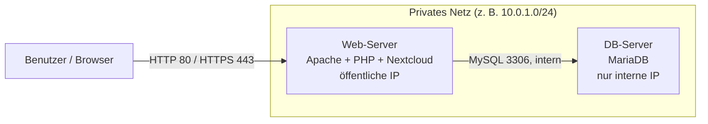

# 1. Architektur

## 1.1 Überblick

| Komponente | Server | Zugriff |
|---|---|---|
| Apache 2.4 + PHP + Nextcloud-Archiv | Web-Server | öffentlich Port 80/443, SSH 22 |
| MariaDB | DB-Server | Port 3306 nur aus dem Web-Subnetz, SSH 22 |

## 1.2 Entscheidungen

| Thema | Entscheidung | Begründung |
|---|---|---|
| Installation | Archiv (`latest.tar.bz2`) nach `/var/www/nextcloud` | Vorgabe: kein Docker, kein Web Installer |
| Integrität | SHA256-Prüfsumme des Archivs wird verglichen | Manipulierte oder defekte Downloads erkennen |
| Document Root | `/var/www/nextcloud` direkt | Aufruf über `http://<IP>/` statt `/nextcloud` (Bewertungskriterium A4) |
| Datenverzeichnis | `/var/nextcloud-data`, ausserhalb des Webroots | Sicherheitsempfehlung von Nextcloud |
| Datenbank | MariaDB auf separatem Server | Vorgabe: getrennte Server |
| DB-Erreichbarkeit | `bind-address` = interne IP, UFW erlaubt 3306 nur vom Web-Subnetz, DB-User nur vom Web-Subnetz | Mehrschichtige Absicherung (Netz, Firewall, Benutzerrechte) |
| Root-Zugang DB | Passwort zusätzlich zu `unix_socket`, Passwort zufällig (24 Zeichen) | Kriterium A4: Root mit sicherem Passwort |
| Passwörter | pro Rendering zufällig, nur in `rendered/` (gitignored) | Keine Secrets im Repository |
| Automatisierung | Cloud-Init führt Bash-Skripte aus | Kriterium A5, funktioniert bei jedem Cloud-Anbieter |
| Bereitstellung AWS | `deploy-aws.sh` mit AWS CLI, Security Group der DB erlaubt nur die Web-SG als Quelle | Ein Befehl genügt (Kriterium A1), Zugriff auf die DB hängt nicht von IP-Bereichen ab |
| Datenbank-Konfiguration | `READ-COMMITTED`, `binlog_format=ROW`, `utf8mb4` | Empfehlungen aus der Nextcloud-Admin-Doku |

## 1.3 Ablauf der Automatisierung

0. Optional: `deploy-aws.sh` übernimmt die Schritte 1-2 und das Starten der Server in AWS.
1. `render.sh` erzeugt zwei `user-data`-Dateien. Diese enthalten die Konfiguration und das jeweilige Install-Skript.
2. Beim ersten Boot schreibt Cloud-Init die Dateien und startet das Skript per `runcmd`.
3. **DB-Server:** MariaDB installieren, an interne IP binden, Datenbank und Benutzer anlegen, Root-Passwort setzen, Firewall aktivieren.
4. **Web-Server:** Apache und PHP-Module installieren, Archiv laden und prüfen, VirtualHost und PHP konfigurieren, Firewall aktivieren, auf die DB warten und die Verbindung testen.
5. Der Web-Server gibt URL, IP und DB-Angaben in der Konsole aus, in `/etc/motd` und in `/root/nextcloud-install-info.txt`.

## 1.4 Sicherheit

- Port 3306 ist weder im Internet noch ausserhalb des Web-Subnetzes erreichbar. Die Cloud-Security-Group sollte dies zusätzlich erzwingen.
- Das DB-Passwort für Nextcloud wird bewusst auf der Konsole ausgegeben (Aufgabenstellung). Die Konsole ist deshalb als sensibel zu behandeln.
- Kein HTTPS im Projektumfang. Für produktiven Einsatz: Let's Encrypt (`certbot --apache`) und eine Domain.
